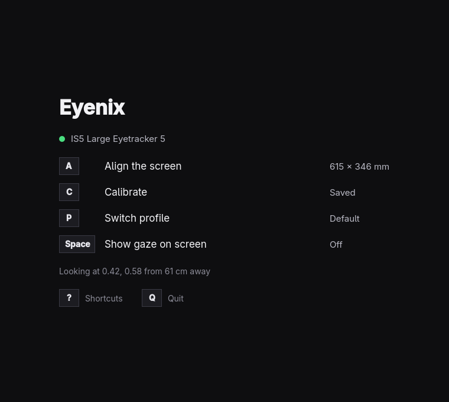

# Eyenix



Use a Tobii Eye Tracker 5 on Linux: set it up, see where you are looking, and
get head and eye tracking in games that support Tobii trackers. Eyenix talks
to the tracker directly over USB, with no Tobii software involved, and runs
on Wayland.

It does four things:

1. **Align** tells the tracker where your screen is. You move two lines until
   they sit above the two marks on the tracker.
2. **Calibrate** fits the tracker to your eyes. You look at seven dots.
3. **Show gaze** draws a circle where you are looking, over the whole desktop.
   Clicks and keys pass through it.
4. **Game mode** lets games that support Tobii trackers use this one, under
   Wine or Proton. See [Games](#games).

Calibrations are kept as named profiles, so glasses and contacts, or two
people, can each have their own. Alignment and profiles are saved in
`~/.config/eyenix` and sent to the tracker each time it connects.

The app only runs while it has something to do: its window, the gaze point,
an alignment or calibration, or game mode. When none of those is up it exits,
which releases the tracker and lets it go idle. With only game mode on it
stays in the background, and holds the tracker only while a game is running.

## Install

```sh
bin/install
```

This builds an Arch package and installs it with `makepkg -fsi`: the binary,
the launcher entry, the icon, the game helper and face models that game mode
uses, and a udev rule that lets you open the tracker without root. Replug the
tracker after the first install so the rule applies.

Building needs Go, for the game helper. One already on your `PATH` is used;
otherwise the `go` package is installed along with the other build
dependencies.

To build and run without installing: `bin/build`, then `build/eyenix`. You
then need the rule in `udev/70-eyenix.rules` in `/etc/udev/rules.d/` yourself.

## Omarchy bar plugin

```sh
eyenix plugin install --enable
```

This copies the plugin to `~/.config/omarchy/plugins/ngharo.eyenix` and adds
it to the bar. The plugin files are carried inside the `eyenix` binary, and
the plugin runs whichever binary installed it, so run the command again
after moving or reinstalling Eyenix. If the panel does not change after an
update, `omarchy restart shell` loads the new code.

- The eye icon lights up in the accent color while eye tracking is running.
- **Show gaze** turns the gaze point on and off. Right-clicking the icon does
  the same.
- **Game mode** turns [game mode](#games) on and off. Underneath, it says
  what is happening: waiting for a game, or which game is using head
  tracking, eye tracking or both. Left on, it comes back by itself after a
  login.
- **Calibration profile** switches profile.
- **Calibrate** redoes the current profile, **New profile** calibrates into a
  new one, and **Align screen** starts alignment.

If the `eyenix` app is removed while the plugin stays in the bar, the panel
says that Eyenix is not installed and how to get it, and its controls are
switched off. It starts working again by itself once the app is back.

Remove it with `omarchy plugin disable ngharo.eyenix`.

## Shortcuts

| Key | Where | Does |
|---|---|---|
| `A` | Main window | Align the screen with the tracker |
| `C` | Main window | Calibrate the current profile |
| `N` | Main window | Calibrate a new profile |
| `P` | Main window | Switch to the next profile |
| `Space` | Main window | Show or hide the gaze point over the desktop |
| `?` | Main window | Show or hide the shortcut list |
| `Q` | Main window | Quit, and turn the gaze point off |
| `←` `→` | Aligning | Move both lines |
| `↑` `↓` | Aligning | Spread the lines apart or bring them together |
| `Shift` | Aligning | Hold for small steps |
| `Enter` | Aligning | Save |
| `Esc` | Aligning | Leave without saving |
| `Enter` | Calibrating | Try again after a failure |
| `Esc` | Calibrating | Stop and keep the old calibration |

Closing the window leaves the gaze point up if it is on.

## From the terminal

These drive the running app, starting it in the background when there is
something to show. None of them needs a display of its own.

```sh
eyenix overlay on|off|toggle      # the gaze point
eyenix align                      # full-screen alignment
eyenix calibrate                  # the current profile
eyenix calibrate --new            # a new profile, named "Profile 2", "Profile 3", …
eyenix calibrate --profile NAME   # that profile, created if new
eyenix games on|off|toggle        # game mode, see below
eyenix profile list
eyenix profile use NAME
eyenix status                     # the app's state as JSON
eyenix status --follow            # again on every change; what the bar plugin reads
eyenix quit
```

Profile names can have letters, digits, spaces, dashes and underscores, up to
32 characters.

`eyenix dump` is separate: it talks to the tracker directly and prints one
line per gaze sample, so it only works while the app is not running.

```sh
eyenix dump --seconds 5
eyenix dump --head --seconds 5    # head position and rotation instead of gaze
```

## Games

Games that support Tobii eye trackers ship Tobii's game integration library,
which looks for Tobii's Windows software. With game mode on, Eyenix answers in
its place, so the game finds a tracker and gets head tracking and gaze. The
game and its files are not touched.

```sh
eyenix games on
```

or the **Game mode** switch in the bar panel. It stays on until you turn it
off, across logins. While it is on:

- Eyenix waits in the background with the tracker released (lights off).
- When a game that ships Tobii's library starts under Wine or Proton, the
  tracker wakes, and a small helper (`eyenix-bridge.exe`) is started inside
  the game's Wine prefix, using the same Wine the game runs on. The game
  talks to that helper for head pose and to Eyenix directly for gaze.
- When the game exits, the helper stops and the tracker is released again.

Align the screen first (`eyenix align`): the game is told which screen the
tracker sits on. Calibration matters for gaze, not for head tracking.

Head position comes from the eye positions the tracker reports; head rotation
from MediaPipe's face models run on the tracker's infrared camera frames, a
few milliseconds of CPU per frame. Camera frames stay in memory and are never
stored or sent anywhere.

Developed against Star Citizen. Game mode listens on `127.0.0.1:4455` (the
port Tobii's library expects) and sends head pose to the helper on UDP
`127.0.0.1:4243`; both are loopback only.

## Layout

```text
lib/        the USB driver (C++20, libusb): protocol codec, Tracker, screen geometry,
            head pose (lib/src/vision is the face pipeline)
src/        the app (Qt Quick): backend, worker thread, control socket, game mode, QML
bridge/     eyenix-bridge.exe (Go): the helper that runs inside a game's Wine prefix
models/     the face models, built by tools/convert_models.py
plugin/     the Omarchy bar plugin (Quickshell QML); compiled into the binary
tests/      Qt Test suite; runs against a fake tracker, no hardware needed
docs/       protocol-notes.md: everything known about the wire protocol
tools/      Python scripts used while decoding the protocol from USB captures
udev/       device permission rule
pkgbuild/   Arch package, launcher entry, icon
```

`bin/test` builds and runs the tests. `bin/test-bridge WINE` also runs the
bridge under a real Wine against a stand-in for a game.

## Limits

- Tested on one tracker (model `IS5_Large_Eyetracker_5`) under Hyprland.
- The gaze point, alignment and calibration use wlr-layer-shell, so they work
  on Hyprland, Sway and KDE, not on GNOME.
- The overlay appears on the screen that was aligned. One screen at a time.
- English only so far. Strings go through `qsTr()`; add `src/i18n/<code>.json`
  catalogs to translate.
- The 184 mm distance between the tracker's marks, which alignment depends
  on, comes from the tobii-linux project. It has not been measured with a
  ruler here, but an alignment done by eye on a 27″ monitor came out at
  597 × 336 mm, which is that panel's real size.
- Game mode: one game at a time; found by the `WINEPREFIX` of running
  processes, so a launcher that hides it will not be seen. Games that insist
  on a Tobii licence are not supported. Head tracking axes cannot yet be
  switched off per game.
- Profiles can be created and switched, not yet renamed or deleted; remove
  `~/.config/eyenix/profiles/<name>.bin` by hand.

## Credits

- The protocol was decoded from USB captures of Tobii's Windows software;
  see `docs/protocol-notes.md`.
- [tobii-linux](https://github.com/njmill/tobii-linux) by njmill (Apache-2.0)
  confirmed the framing and supplied names for several operations, the
  session open and close requests, and the mark spacing.
- Game integration is ported from
  [tobii-faithful](https://github.com/SciFi-Bob/tobii-faithful) by SciFi-Bob
  (Apache-2.0): the face pipeline and head pose maths (`lib/src/vision`,
  `lib/src/headpose.cpp`), what a game is told about the tracker
  (`src/gameserver.cpp`, `src/gamereplies.h`), how running games are found
  (`src/wineprefix.cpp`), and the message formats of the Wine helper
  (`bridge/`). See `THIRD-PARTY-NOTICES.md`.
- The face models and face geometry data are MediaPipe's (Apache-2.0).
- Theme and language following come from the Omarchy app templates (MIT,
  David Heinemeier Hansson).

Eyenix is not affiliated with or endorsed by Tobii.
